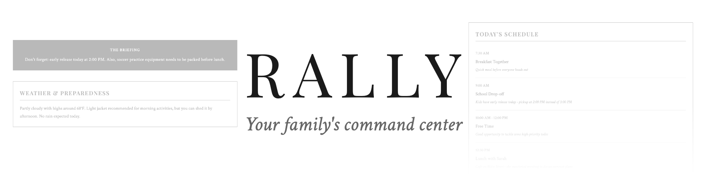
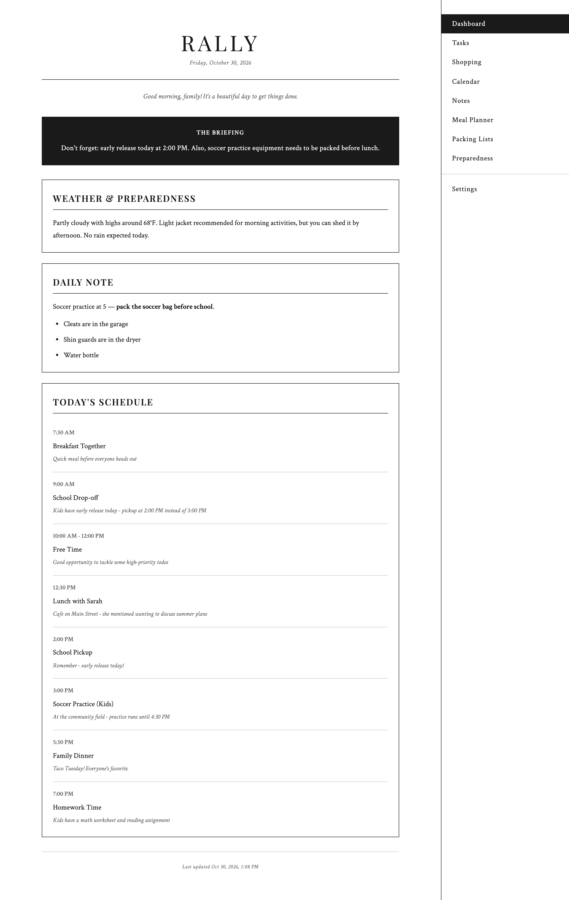
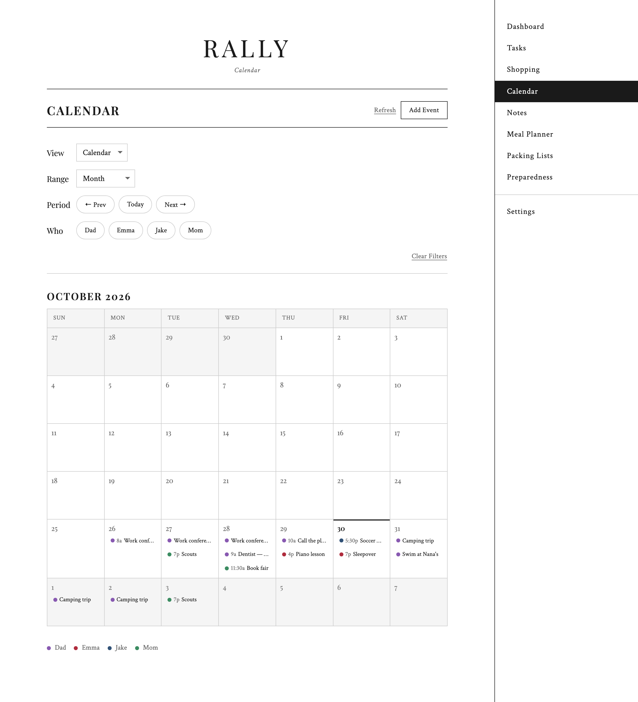
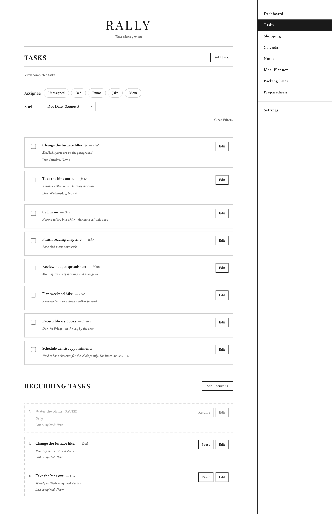
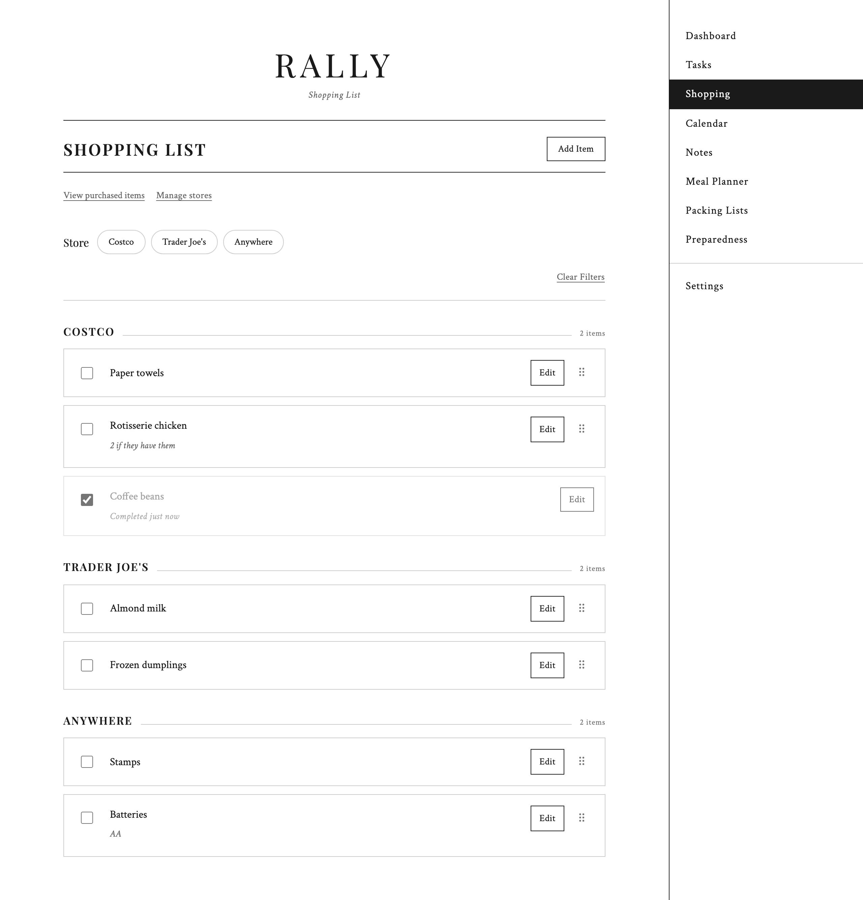
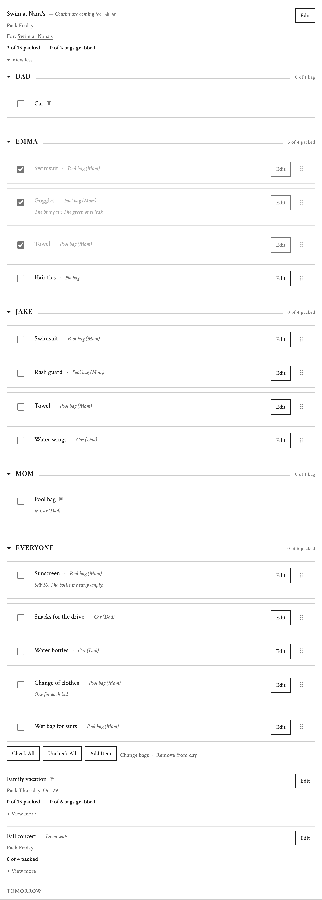
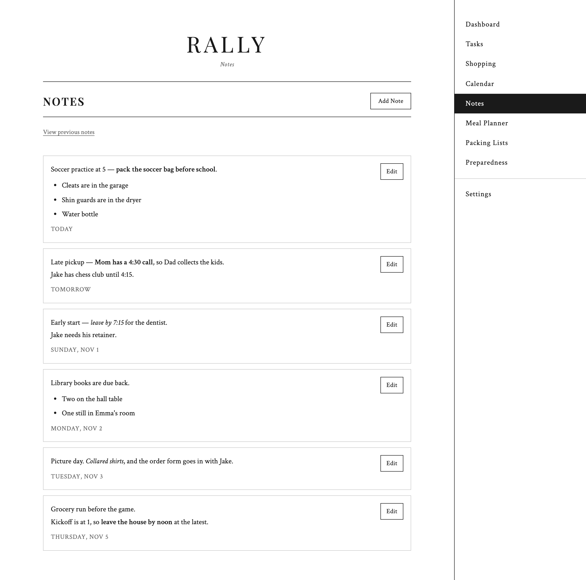
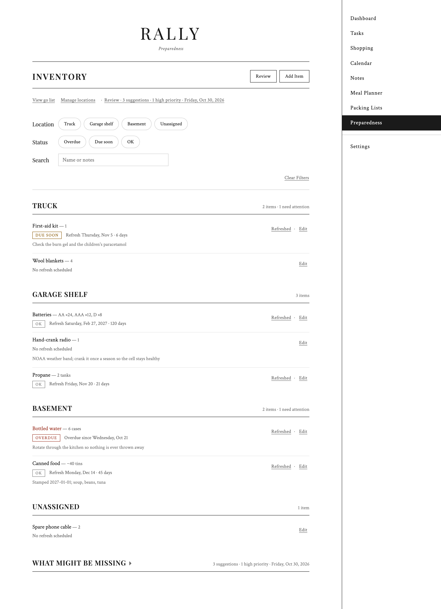
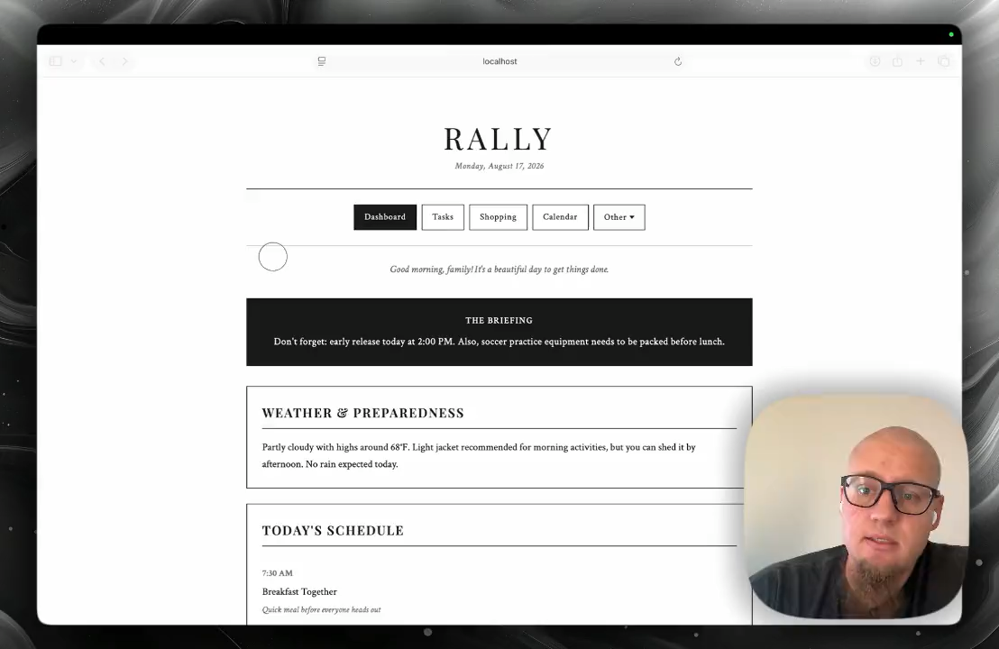
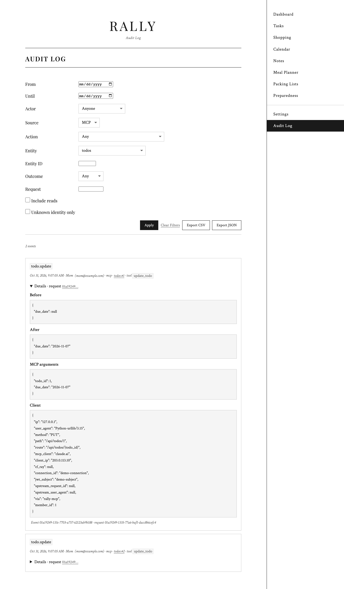

<p align="center"></p>

> [!IMPORTANT]
> **Asset to create: `assets/banner.png`.** 1760×440 PNG (shown at 880 wide), on Rally's paper-white background. Show the RALLY wordmark in Playfair Display, letterspaced as in the app header, with the tagline "Your family's command center" in Crimson Text italic below it. Behind it, use a faint grayscale strip of the dashboard: briefing, weather and schedule. Grayscale only, so it matches the e-ink-friendly design. Also export `assets/logo.svg` (wordmark only) for social previews. Delete this callout once it's in.

<p align="center">
  <a href="LICENSE"></a>
  <a href="https://github.com/pid1/rally/actions/workflows/tests.yml"></a>
  <a href="https://github.com/pid1/rally/pkgs/container/rally"></a>
  <a href="docs/mcp.md"></a>
</p>

<p align="center">
  <a href="docs/features.md">Tour</a> •
  <a href="docs/installation.md">Install</a> •
  <a href="docs/configuration.md">Configure</a> •
  <a href="docs/mcp.md">Claude (MCP)</a> •
  <a href="docs/audit-log.md">Audit log</a> •
  <a href="docs/development.md">Develop</a>
</p>

<p align="center"><em>One shared plan for the day, on every screen in the house.</em></p>

## What is Rally?

Rally is the family command center you host yourself. It keeps one calendar, one task list, one shopping list, tonight's dinner, the packing lists and the emergency kit for the whole household. Every morning it turns all of that, plus the weather, into a short plain-language briefing.

It runs on your own hardware, and your family's schedule stays in the house. Ask Claude about your day and it answers from Rally, under your own sign-in, and every call is on the record.



## A day with Rally

1. **4 AM.** Rally reads every calendar, the forecast, what's due and what's for dinner, and writes the family's briefing.
2. **Breakfast.** The kitchen display shows it. A note for the day ("bag packed before school") sits between the weather and the schedule.
3. **During the day.** Hand a task to someone and only their phone buzzes. Move the dentist and only the people going hear about it.
4. **On the way home.** "Hey Siri, add milk to Rally." Or ask Claude what's left on the list.
5. **Evening.** Tomorrow's packing lists are already on tomorrow, sorted by who packs what and which bag it goes in.

## What it does

- **Writes the morning briefing** from your calendars, forecast, tasks, dinner and anything overdue, with the AI provider you choose.
- **Shares one calendar** beside Google, iCloud and any ICS feed: color-coded by person, with recurring events and per-occurrence edits.
- **Notifies only the people involved**, by Pushover. Assignees hear about their tasks, attendees about their events.
- **Runs the shopping list**, grouped by shop, autocompleted from what you've bought before, and addable by voice.
- **Plans dinners** and remembers how they went.
- **Packs for you**: templates, bags inside bags, items per person, and lists that ride along with calendar events.
- **Tracks the emergency kit**: what's where, what expires when, a daily digest, and a printable go list.
- **Works with Claude** through a remote MCP connector behind Cloudflare Access, so the whole household can use Rally from claude.ai and Claude Code.
- **Records everything.** Every read and write, from the web, the API, Claude or a background job, goes in an append-only audit log with who did it.

| | |
|---|---|
|  |  |
|  |  |
|  |  |

The full tour, feature by feature: **[docs/features.md](docs/features.md)**.

## Watch the tour

A ten-minute walk through the whole app, recorded against a seeded demo instance.

<video src="https://github.com/user-attachments/assets/5c63ade2-e276-4239-afb2-73626440a270" controls muted playsinline>
  <a href="https://github.com/pid1/rally/releases/download/demo-2026-08-17/rally-demo.mp4"></a>
</video>

You can run the same demo yourself in about a minute: see [docs/development.md](docs/development.md#the-demo-instance).

## Works with Claude

Connect Rally to Claude once, and anyone in the household can ask "what's on today?", "add sunscreen to the beach-day list", "what in the emergency kit expires this month?" or "plan dinners for next week". Claude can do nearly everything you can in Rally. That works from claude.ai on the web, the desktop and mobile apps, voice, and Claude Code. Each person signs in with their own GitHub account through Cloudflare Access. Only the people you list get in, Rally itself never leaves your network, and each call is in the audit log under the person who made it.


> [!IMPORTANT]
> **Asset to create: `docs/screenshots/readme-claude.png`.** 1600×1000 PNG of claude.ai (light theme) with the Rally connector enabled. Show a short exchange: "What's on for the family today?", with the expanded Rally tool call (`list_events` and `list_todos`), and Claude's answer listing two or three events and a to-do. Use the seeded demo data (`demo`), never the real household. Crop to the conversation and blur the account name. Delete this callout once it's in.

Setup takes about half an hour and is done once. **[docs/mcp.md](docs/mcp.md)** has the step-by-step guide, troubleshooting, and a prompt you can hand to an agent to do it for you.

## Install

Rally ships as a Docker container:

```bash
docker run -d \
  -p 8000:8000 \
  -v $(pwd)/data:/data \
  --name rally \
  --restart unless-stopped \
  ghcr.io/pid1/rally:latest
```

Open `http://localhost:8000/settings` and add your timezone, your family, an AI provider key and a weather forecast URL. Everything else can wait.

Requirements, upgrades, environment variables and remote access are in **[docs/installation.md](docs/installation.md)**. Backups (scheduled, client-side encrypted, offsite) are in [docs/backup.md](docs/backup.md).

## Who did what



> [!IMPORTANT]
> **Asset to create: `docs/screenshots/readme-audit-log.png`.** 1600×1000 PNG of `/audit` on the seeded demo instance, desktop width. Filter to source MCP with reads hidden, and expand one `todo.update` event so its before/after diff and client details show. It can be generated: add an `/audit` capture to `scripts/capture_screenshots.py` after seeding a few MCP calls, then run `screenshots`. Delete this callout once it's in.

Rally has no logins, but it still knows who did what. Every read and write is recorded with the person, device or Claude connection behind it, append-only, with secrets redacted. You can filter it, see a request's every effect, follow one to-do's history, or export it. See [docs/audit-log.md](docs/audit-log.md).

## Design principles

- **The house is the boundary.** Self-hosted, on your LAN or tailnet. Nothing leaves except what you send your AI provider, and what Claude asks for on your behalf.
- **No logins, still accountable.** A shared kitchen screen shouldn't need a password. Every action is still attributed and kept.
- **Tell only who it concerns.** Notifications go to the assignee or the attendees, never the whole family.
- **One screen, many sizes.** Phone first, up to a wall display, and grayscale and typographic so it reads on e-ink.
- **Off until you turn it on.** Optional features, the Claude connector included, are switches in Settings that start off.
- **Encouraging, not nagging.** The briefing frames a full day as a good one.

## Documentation

| Guide | What's in it |
|---|---|
| [A tour of Rally](docs/features.md) | Every feature, with screenshots |
| [Installation](docs/installation.md) | Requirements, Docker deployment, upgrades, environment variables |
| [Configuration](docs/configuration.md) | Settings UI, AI providers, weather, calendars, Pushover notifications |
| [Claude (MCP)](docs/mcp.md) | Connecting Claude through Cloudflare Access: setup, tools, alerts, troubleshooting |
| [Audit log](docs/audit-log.md) | Every read and write, who made it, and how to investigate |
| [Voice shortcuts](docs/voice-shortcuts.md) | Adding shopping items with Siri and Apple Shortcuts |
| [Backups](docs/backup.md) | Scheduled, client-side-encrypted offsite backup |
| [Development](docs/development.md) | Local setup, commands, tests, database migrations, the demo instance |
| [Design system](docs/visual-design-system.md) | Typography, spacing, components and how they are enforced |

## Contributing

Pull requests are welcome. Run `check` and the test suite before submitting, as described in [docs/development.md](docs/development.md). If you are an AI agent working in this repository, read **[AGENTS.md](AGENTS.md)** first.

## License

BSD 3-Clause. See [LICENSE](LICENSE).
